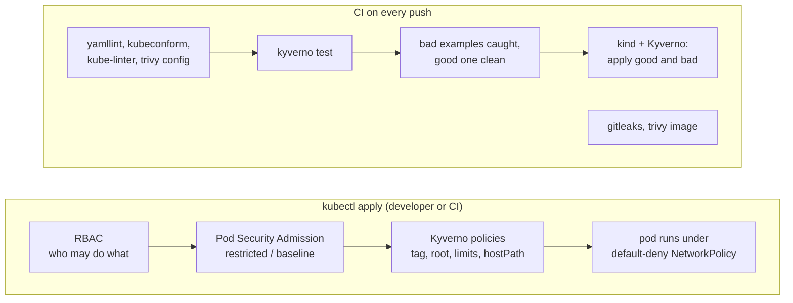

# k8s-security-baseline

[](https://github.com/Walaskien/k8s-security-baseline/actions/workflows/ci.yml)

Out of the box a Kubernetes namespace lets you run a root container from `:latest`, mount the Docker socket from the node, and talk to every other pod. Nothing stops a tired developer or a copied manifest from doing all three.

This repo is a small baseline for one team namespace that closes those defaults, plus the checks that show it works: manifests for RBAC, Pod Security Admission and NetworkPolicy, four Kyverno policies with unit tests, a good and a bad set of example manifests, and CI that insists the bad ones are refused and the good one is not.

## How the pieces fit



The layers overlap a little on purpose. Pod Security Admission knows about privileged pods and host namespaces but not about image tags or resource limits. Kyverno covers those, and for Deployments it answers at `kubectl apply` time. For a Deployment, Pod Security Admission only warns, and the pod is refused later by the ReplicaSet, which is a worse place to find out.

What is in `baseline/`:

- `team-a` namespace with Pod Security `restricted` (enforce, audit, warn), and `legacy-apps` with `baseline` enforced and `restricted` as a warning, for workloads that cannot comply yet.
- Three roles in `team-a`: `developer` (deploys, reads logs, port-forward, no Secrets, no exec, network policies and ingresses read-only), `ci-deployer` (a ServiceAccount, patch and create only, no delete, no Secrets, short-lived token) and `readonly`.
- `default-deny-all` for ingress and egress, and a DNS exception that only reaches the cluster DNS pods.
- A ResourceQuota.

What is in `policies/` (Kyverno `ValidatingPolicy`, CEL): `disallow-latest-tag`, `require-run-as-non-root`, `require-resource-limits`, `disallow-hostpath`. Memory limit and both requests are required; a CPU limit is not, because it mostly adds throttling.

## Quick start

Static checks. Needs Docker, make and Python for yamllint; every other tool runs from a pinned container image.

```console
python3 -m venv .venv && . .venv/bin/activate && pip install -r requirements-dev.txt
make check          # lint, kyverno test, bad/good examples, trivy config, gitleaks
make scan-image     # trivy on the image used by examples/good
```

End to end on a throwaway kind cluster (this is what the `e2e` job does):

```console
kind create cluster --name baseline --config kind/kind-config.yaml
helm repo add kyverno https://kyverno.github.io/kyverno/
helm install kyverno kyverno/kyverno --version 3.9.2 -n kyverno --create-namespace --wait
scripts/e2e.sh
```

On your own cluster, start with `kubectl apply -f baseline/namespaces.yaml`, then `kubectl apply -R -f baseline/` and `kubectl apply -f policies/`. Change the group names in `baseline/rbac/` to the ones your identity provider sends. The CI pipeline gets a token with `kubectl -n team-a create token ci-deployer --duration=1h`. Try the bad examples with `kubectl apply --dry-run=server -f examples/bad/bad-root.yaml` before you trust any of this.

## Verified

Locally on macOS (arm64) with Docker through Colima, in the same containers the Makefile uses, and then on GitHub Actions.

| Check | Result |
|---|---|
| `yamllint -s .` (1.37.1) | no findings |
| kubeconform 0.7.0, strict, Kubernetes 1.34.0, Kyverno schemas from the datree CRD catalog | 20 resources valid. As a control, an unknown field added to a policy copy was reported as invalid |
| kube-linter 0.8.3 on `baseline/` and `examples/good/` | no lint errors |
| `kyverno test` (CLI 1.19.2) | 39 passed, 0 failed: 4 policies, 18 resources, including registry ports, digests, init containers, CronJob. As a control, `:latest` in a scratch copy of the good example made it fail |
| `make negative` | all six files in `examples/bad/` are flagged by kube-linter and trivy config. The four Kyverno cases fail exactly their own policy and pass the other three. The two Pod Security cases pass Kyverno, as intended. `examples/good/` is clean in all three tools |
| `trivy config` 0.76.2 on `baseline/` and `examples/good/` | 0 findings, after the accepted ones listed with reasons in `.trivyignore.yaml` |
| gitleaks 8.30.1, git history and files | no leaks. As a control, a made-up GitHub token in a scratch file was found |
| actionlint 1.7.12 on `ci.yml`, shellcheck 0.10.0 on `scripts/` | no findings |
| the good image with `--read-only --tmpfs /tmp --user 10101 --cap-drop ALL` in plain Docker | starts and answers 200, so the securityContext in the manifest does not break nginx |
| GitHub Actions `ci`, run 42965078008 on commit c30252d, runner `ubuntu-24.04` (image 20261101.360.1) | green in about 2 minutes: `lint` 18 s, `policies` 27 s, `scan` 24 s, `secrets` 6 s, `e2e` 1 min 24 s. The e2e job uses kind v0.33.0 with node v1.34.11 and Kyverno 1.19.2 from the Helm chart, and `scripts/e2e.sh` reports 30 checks passed: 20 `kubectl auth can-i` checks across the three roles, seven rejections of bad manifests with the expected policy or Pod Security message, two acceptances, and the good Deployment rolled out. The first ever run (42964436141) was red in `scan-image`, see below; the one after it (42964771143) was green |

Not verified:

- **NetworkPolicy enforcement.** Nothing here sends traffic. See below.
- **`make scan-image`** is green only because of a documented exception: the first CI run found a fixable CRITICAL (`brotli-libs`) in the pinned nginx image and no newer tag was rebuilt yet. The entry is in `.trivyignore.yaml` and has to go once the image is rebuilt. The check can turn red whenever a new finding appears; the fix is a newer tag.

## Limitations

- Network policies are only as good as the CNI. The e2e job checks that the API server accepts them, not that packets are dropped. The default CNI of kind may not enforce them at all.
- The Kyverno policies are `ValidatingPolicy` objects and need Kyverno 1.19 or newer (pinned to 1.19.2, Helm chart 3.9.2). I wrote them in the new format because the 1.20 release candidates remove the old `ClusterPolicy` engine.
- No image signing, no registry allow list, no runtime detection. [docs/threat-model.md](docs/threat-model.md) has the full list of what is and is not covered.
- The example workload is a public nginx image, used as a stand-in. Quota numbers are placeholders, and the Pod Security labels are pinned to `v1.31` and need a look when you upgrade.
- kubeconform gets the Kyverno schemas from a third-party catalog on GitHub. If that goes away, the `lint` job fails until the schema location is changed.

## Layout

```
baseline/             namespaces, quota, rbac/, networkpolicy/
policies/             four Kyverno ValidatingPolicy files
examples/good/        a Deployment that passes everything, plus its Service and NetworkPolicy
examples/bad/         one defect per file, six files
tests/kyverno/        kyverno test: results for good, bad and edge cases
scripts/              e2e.sh (needs a cluster), check-examples.sh (negative tests for the scanners)
kind/                 single-node cluster config for the e2e job
docs/threat-model.md  one page
Makefile              all checks, each tool from a pinned image
.github/workflows/    ci.yml
```

## Related

- [cicd-k8s-delivery](https://github.com/Walaskien/cicd-k8s-delivery): a small app delivered to a kind cluster from CI. This baseline is what I would put in front of that cluster.
- [ansible-linux-baseline](https://github.com/Walaskien/ansible-linux-baseline): the host side of the same idea, which this repo does not touch.
